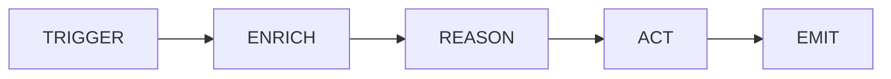
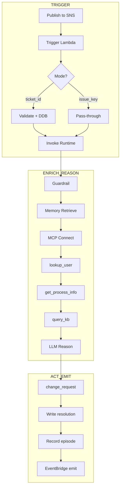
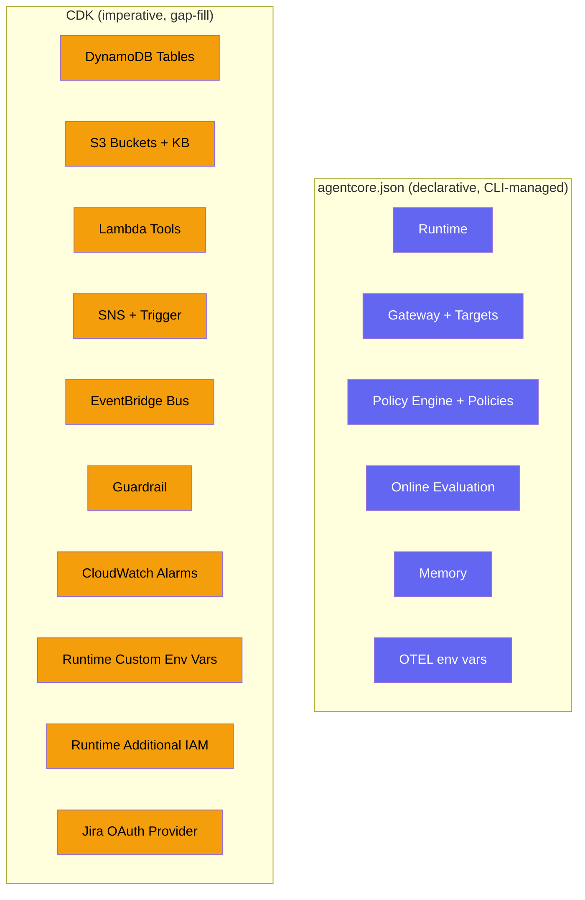
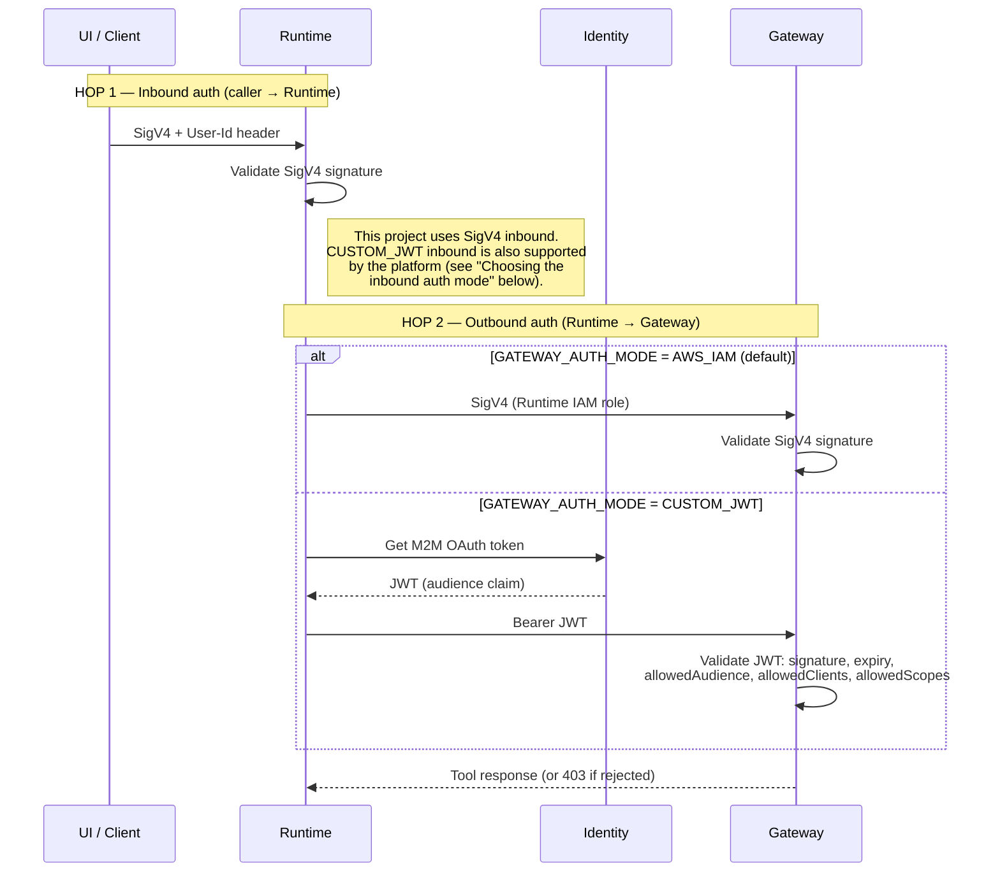
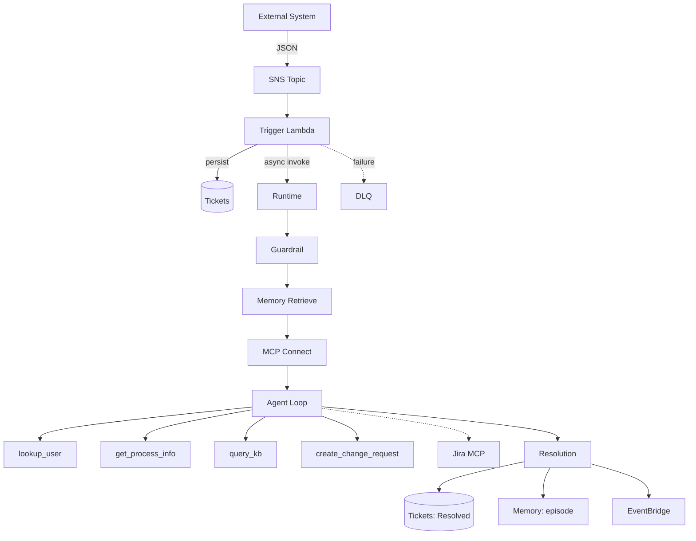
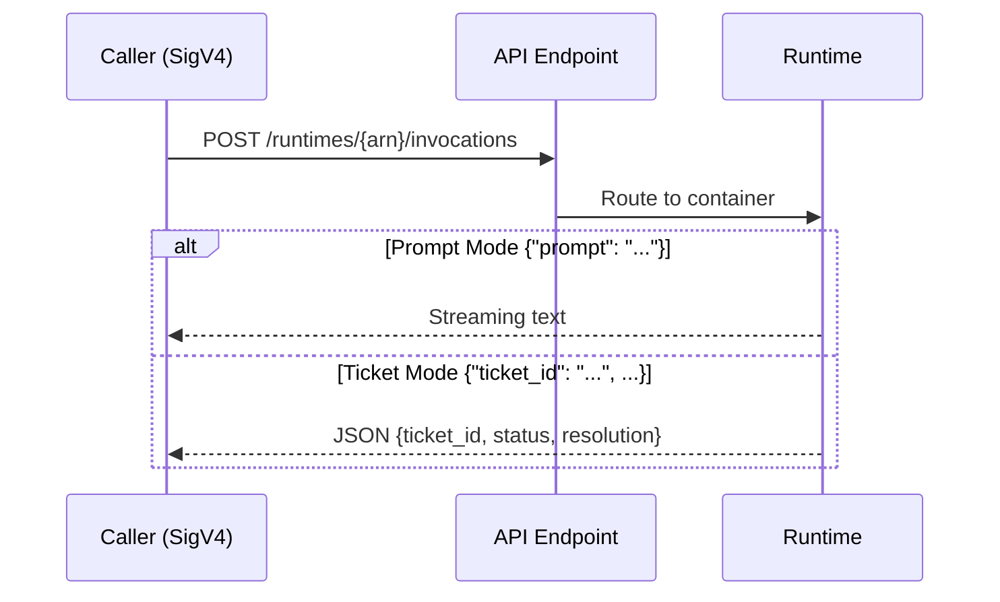
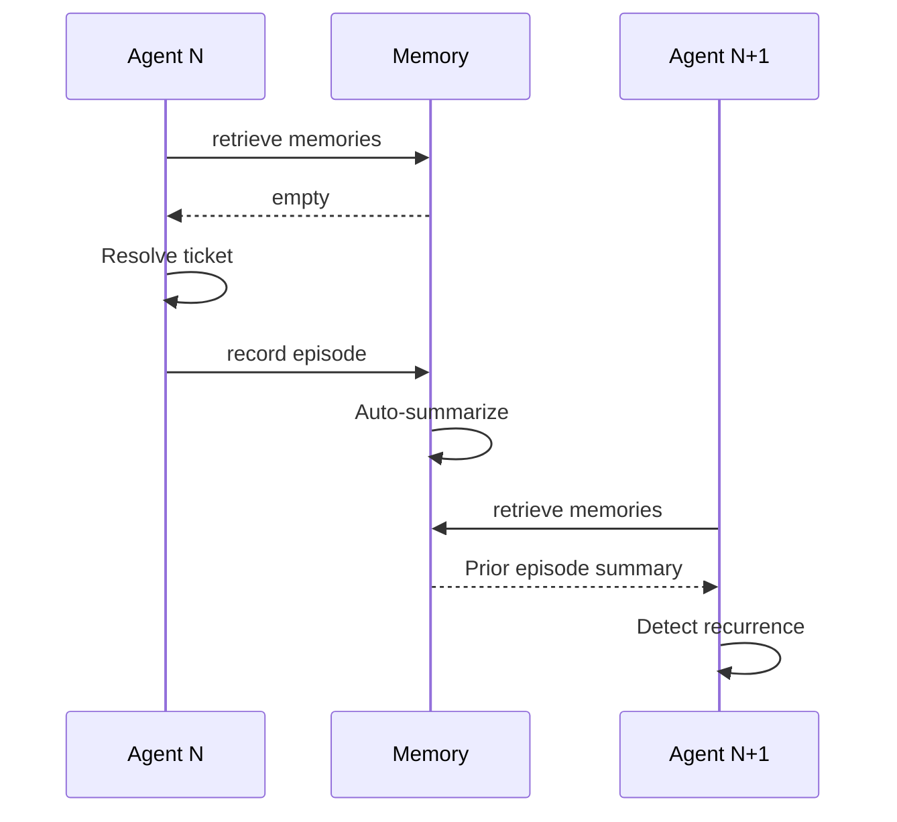

# Architecture Guide: IT Incident Response Agent

> ภาษาอื่น: [English](ARCHITECTURE.md)

เอกสารนี้คือ **guided tour** ของ accelerator ตัวนี้ แนะนำให้อ่านเป็นไฟล์แรก

---

## The Pattern: Trigger → Enrich → Reason → Act → Emit

Event-driven agent ทุกตัวทำงานตาม pattern 5 ขั้นตอนนี้ ตารางด้านล่างแสดงว่าแต่ละขั้นตอนอยู่ตรงไหนในโค้ด:

```
┌─────────────────────────────────────────────────────────────────────────────┐
│                                                                             │
│  ① TRIGGER        ② ENRICH           ③ REASON         ④ ACT     ⑤ EMIT   │
│                                                                             │
│  SNS message  →  lookup_user      →  LLM decides  →  create_    →  Event-   │
│  arrives         get_process_info     from runbook     change_      Bridge  │
│  (ticket or      query_kb                              request      event   │
│   issue_key)     Memory recall                        Jira comment          │
│                  [Jira: fetch issue]                   DDB update           │
│                                                                             │
│  ticket_event_   Gateway tools +     System prompt    Gateway     _emit_    │
│  handler.py      Jira MCP tools      in main.py       tool /      resolut-  │
│                  (multi-MCP)                          Jira MCP    ion_      │
│                                                                   event()   │
└─────────────────────────────────────────────────────────────────────────────┘
```



---

## Numbered Sequence (ลำดับเหตุการณ์เมื่อ ticket เข้ามา)




### 1. **External System** publish event ไปยัง SNS topic

รองรับ 2 รูปแบบ:
- Ticket แบบเต็ม: `{ticket_id, requester_id, title, description, priority}`
- Jira issue key: `{issue_key, requester_id}`

### 2. **SNS** ส่งต่อไปยัง Trigger Lambda
  
**File:** `lambdas/trigger/ticket_event_handler.py`

**Step:** TRIGGER

- ตรวจจับ mode: `issue_key` หรือ `ticket_id`
- Full-ticket: validate schema แล้วเขียนลง DDB (idempotent ด้วย `attribute_not_exists`)
- Issue-key: เป็น thin pass-through (Jira เป็น system of record)
- เรียก `InvokeAgentRuntime` (async, fire-and-forget)

### 3. **AgentCore Runtime** รับ payload แล้วเริ่มรัน `main.py`

**File:** `app/ITIncidentAgent/main.py`

- ตรวจจับ mode จาก payload (`issue_key` หรือ `ticket_id`)
- ดึงสรุป incident ในอดีตจาก **AgentCore Memory**
- สร้าง system prompt แบบ dynamic โดยใส่ memory context เข้าไป
- เชื่อมต่อ MCP server (Gateway และ Jira แบบ optional)
- สร้าง **Strands Agent** พร้อม tool ที่รวมมาจากทุกแหล่ง

### 3b. **Agent** ใช้ Bedrock Guardrail (เฉพาะ DDB mode)

**File:** `app/ITIncidentAgent/main.py` → `_apply_guardrail()`

**Step:** GUARDRAIL

- กรอง PII, คำหยาบ และ injection attempt ออกจาก event payload
- ทำงานแบบมีเงื่อนไข: active เฉพาะเมื่อตั้งค่า `GUARDRAIL_ID`
- ข้ามใน Jira mode (เนื้อหา issue ดึงจาก Jira ไม่ได้มาจาก payload)

### 3c. **Agent** ดึง context ของ incident ในอดีตจาก Memory

**File:** `app/ITIncidentAgent/memory/enrichment.py`

**Step:** MEMORY ENRICHMENT

- เรียก `retrieve_memories` ด้วย namespace ของผู้แจ้ง (`incidents/{actor_id}`)
- ใส่ summary ลงใน system prompt เพื่อให้ตรวจจับ incident ที่เกิดซ้ำได้

### 4. **Agent** (Jira mode) ดึง issue ผ่าน Atlassian MCP

**Tool:** `jira___getIssue`

**Step:** ENRICH

- อ่าน summary, description และ status ของ issue จาก Jira

### 5. **Agent** เรียก `lookup_user` ผ่าน Gateway → Lambda

**File:** `lambdas/tools/lookup_user.py`

**Step:** ENRICH

- คืนค่า user profile, quota และ `recent_incident_count_30d`

### 6. **Agent** เรียก `get_process_info` ผ่าน Gateway → Lambda

**File:** `lambdas/tools/get_process_info.py`

**Step:** ENRICH

- คืนค่า service status, `owner_team` และ `known_issues`

### 7. **Agent** เรียก `query_kb` ผ่าน Gateway → Lambda

**File:** `lambdas/tools/query_kb.py`

**Step:** REASON (retrieval เพื่อใช้ประกอบการ reasoning)

- ค้นหาคำแนะนำจาก runbook ใน Bedrock KB (ผลลัพธ์ top_k)

### 8. **Agent** LLM วิเคราะห์เพื่อวินิจฉัย

**Step:** REASON

- System prompt กำหนดลำดับการเรียก tool
- Context ของ incident ในอดีตช่วยตัดสินใจเรื่อง escalation
- ตัดสินใจว่า runbook กำหนดให้ต้องทำ corrective action หรือไม่

### 9. **Agent** เรียก `create_change_request` ผ่าน Gateway → Lambda

**File:** `lambdas/tools/create_change_request.py`

**Step:** ACT

- บันทึก change ลง DynamoDB (`CHANGES_TABLE`)
- อัปเดต user record (`incident_count++`, `last_incident_at`)

### 10. **Agent** เขียน resolution

**Step:** ACT

- DDB mode: `_resolve_ticket()` → เขียนลงตาราง Tickets (`status=Resolved`)
- Jira mode: `jira___addComment` + `jira___transitionIssue` ผ่าน MCP

### 11. **Agent** บันทึก episode ลง AgentCore Memory

**File:** `app/ITIncidentAgent/memory/session.py`

- `AgentCoreMemorySessionManager` ที่ผูกกับ `Agent` จะ persist
  conversation turn ให้อัตโนมัติ ไม่ต้องเรียก `create_event` เอง
- SUMMARIZATION strategy จะรวม event เป็น episode ต่อผู้ใช้
- Invocation ครั้งถัดไปจะดึงข้อมูลเหล่านี้ผ่านขั้นตอน 3c

### 12. **Agent** emit event `TicketResolved` ไปยัง EventBridge

**File:** `app/ITIncidentAgent/main.py` → `_emit_resolution_event()`

**Step:** EMIT

- Source: `it-incident-agent`
- DetailType: `TicketResolved`
- Downstream consumer subscribe ผ่าน EventBridge rule

---

## Real-Time Progress Streaming

Entrypoint เป็น **async generator** ดังนั้น AgentCore Runtime จะ stream ทุก
`yield` ไปยังผู้เรียกในรูป Server-Sent Event (`text/event-stream`) agent ใช้กลไกนี้
เพื่อแสดงความคืบหน้าจริงของแต่ละ phase แทนที่จะส่งผลลัพธ์ก้อนเดียวตอนจบ:

- ที่ขอบเขตของแต่ละ phase จะ yield marker แบบมีโครงสร้าง
  `{"type": "stage", "stage": <id>, "label": ..., "detail": ...}` โดยเรียงตาม
  `guardrail` → `memory` → `tools` → `diagnose` → (marker `tool` หนึ่งตัวต่อการเรียก
  tool จริงแต่ละครั้ง) → `persist` → `emit`
- ลูป REASON/ACT รันผ่าน `agent.stream_async(...)` (ไม่ใช่การเรียก `agent(...)` แบบ
  blocking) ดังนั้นการเรียก tool จริงแต่ละครั้ง (`lookup_user`,
  `get_process_info`, `query_kb`, `create_change_request`, Jira tools) จะถูกประกาศ
  ทันทีที่โมเดลตัดสินใจเรียก (dedupe ด้วย `toolUseId`)
- **ผลลัพธ์สุดท้าย** ยังถูก yield เป็นอันสุดท้ายในรูป
  `{"ticket_id", "status", "resolution", ...}` ผู้ใช้ที่ buffer response ทั้งก้อนแล้วหยิบ
  JSON object สุดท้าย (เช่น trigger Lambda และ test) จึงไม่ได้รับผลกระทบ
  เพราะ stage marker มี `"type": "stage"` และจะถูกข้ามไปโดยการ parse แบบ
  last-object-wins

> หมายเหตุ: Runtime จะ `json.dumps()` ทุกค่าที่ yield ออกมา ดังนั้นสตริง
> `json.dumps({...})` ที่ yield จะถูก encode ซ้อนสองชั้นบน wire
> (`data: "{...}"`) ฝั่ง streaming consumer ต้อง decode แต่ละบรรทัดสองรอบ (string → dict)
> เพื่อกู้ marker กลับมา ซึ่ง `_extract_resolution` ของ dashboard ก็ decode
> สองรอบแบบนี้อยู่แล้ว

---

## File Map (แต่ละส่วนอยู่ที่ไหน)

### Configuration (source of truth)

| File | Role | When to Edit |
|------|------|--------------|
| `agentcore/agentcore.json` | ประกาศ Runtime, Gateway (semantic search + DEBUG), Online Eval, Policy Engine, target | เพิ่ม/ลบ AgentCore resource |
| `agentcore/aws-targets.json` | Deploy target (account + region) | เปลี่ยนปลายทางที่ deploy |
| `.env.example` | Template ของ environment variable | เพิ่ม config ใหม่ |

### Agent Code (สิ่งที่รันอยู่ใน Runtime container)

| File | Role | Step |
|------|------|------|
| `app/ITIncidentAgent/main.py` | Entrypoint ควบคุม flow ทั้งหมด (dual-path) | ทั้ง 5 ขั้นตอน |
| `app/ITIncidentAgent/mcp_client/client.py` | เชื่อมต่อ Gateway ผ่าน MCP + รวม multi-MCP | ENRICH |
| `app/ITIncidentAgent/mcp_client/jira.py` | เชื่อมต่อ Atlassian Remote MCP (opt-in, 3LO auth) | ENRICH + ACT |
| `app/ITIncidentAgent/memory/session.py` | AgentCore Memory session manager (persist turn) | Post-ACT |
| `app/ITIncidentAgent/memory/enrichment.py` | ดึง incident ในอดีตจาก Memory (ข้าม session) | Pre-REASON |
| `app/ITIncidentAgent/model/load.py` | สร้างโมเดล Claude Platform on AWS (SigV4, workspace) + cost routing | REASON |
| `app/ITIncidentAgent/Dockerfile` | ไฟล์กำหนด container image | — |

### Tool Lambdas (สิ่งที่ Gateway เรียกใช้)

| File | Role | Step |
|------|------|------|
| `lambdas/tools/lookup_user.py` | User profile + incident ล่าสุด | ENRICH |
| `lambdas/tools/get_process_info.py` | Asset catalog ของ service/process | ENRICH |
| `lambdas/tools/query_kb.py` | Knowledge Base retrieval | REASON |
| `lambdas/tools/create_change_request.py` | บันทึก corrective action | ACT |

### Trigger Lambda (event ingress)

| File | Role | Step |
|------|------|------|
| `lambdas/trigger/ticket_event_handler.py` | SNS → ตรวจจับ mode → validate → (DDB หรือ pass-through) → เรียก Runtime | TRIGGER |

### Infrastructure Lambdas (custom resource)

| File | Role |
|------|------|
| `lambdas/infra/seeder.py` | Seed ข้อมูลลงตาราง DDB ตอน deploy |
| `lambdas/infra/jira_oauth_provider.py` | ลงทะเบียน AtlassianOauth2 credential provider (opt-in) |

### Infrastructure (CDK)

| File | Role |
|------|------|
| `agentcore/cdk/lib/cdk-stack.ts` | Stack หลัก: AgentCore (Runtime, Gateway, Memory, Online Eval, Policy Engine) + Infra + custom env var |
| `agentcore/cdk/lib/infra-construct.ts` | Gap-fill: DDB, S3, Lambda, SNS, EventBridge, Guardrail, KB, alarm |
| `agentcore/cdk/bin/cdk.ts` | CDK app entry: อ่าน agentcore.json แล้วสร้าง stack |

### Operational Scripts

| Script | Purpose |
|--------|---------|
| `scripts/deploy.sh` | Deploy ทุกอย่าง |
| `scripts/destroy.sh` | ลบ resource ทั้งหมด |
| `scripts/publish_ticket.sh` | ส่ง test ticket ไปที่ SNS |
| `scripts/show_ticket.sh` | ตรวจสอบผล resolution ของ ticket ใน DDB |
| `scripts/evaluate.py` | ดึงผล online evaluation |
| `scripts/test-e2e.sh` | End-to-end test: publish → poll → assert Resolved (เหมาะกับ CI) |
| `scripts/enable-custom-jwt.sh` | อัปเกรด gateway ไปใช้ Auth0/OIDC auth |

---

## AgentCore Primitives (อะไรคือ AgentCore และอะไรคือส่วนของคุณ)


<details>
<summary>ASCII Diagram ของสถาปัตยกรรมภาพรวม (รายละเอียดเพิ่มเติม)</summary>

```text
┌──────────────────────────────────────────────────────────────────────────────┐
│                         AgentCore (managed services)                         │
│                                                                              │
│  ┌───────────────┐  ┌───────────────┐  ┌──────────────────────────────────┐  │
│  │    Runtime    │  │    Memory     │  │            Gateway               │  │
│  │               │  │               │  │                                  │  │
│  │  Strands      │  │ SUMMARIZATION │  │  Protocol: MCP (StreamableHTTP)  │  │
│  │  agent in     │  │ strategy      │  │  Auth: AWS_IAM / CUSTOM_JWT      │  │
│  │  container    │  │               │  │  Semantic Search: enabled        │  │
│  │  (Python 3.12)│  │  Episodes per │  │                                  │  │
│  │               │  │  user/incident│  │  ┌────────┐┌────────┐┌────────┐  │  │
│  │  Cost routing:│  │               │  │  │lookup- ││get-    ││create- │  │  │
│  │  Haiku (LOW)  │  │  Namespace:   │  │  │user    ││process-││change- │  │  │
│  │  Sonnet (MED+)│  │  incidents/   │  │  │        ││info    ││request │  │  │
│  │               │  │  {actor}/     │  │  └────────┘└────────┘└────────┘  │  │
│  │  Guardrail:   │  │  {session}    │  │  ┌────────┐                      │  │
│  │  PII filter   │  │               │  │  │query-  │ (if KB_ID set)       │  │
│  │  before model │  │               │  │  │kb      │                      │  │
│  └───────────────┘  └───────────────┘  │  └────────┘                      │  │
│                                        └──────────────────────────────────┘  │
│                                                                              │
│  ┌──────────────────┐  ┌──────────────────┐  ┌───────────────────────────┐   │
│  │   Identity       │  │  Policy Engine   │  │    Online Evaluation      │   │
│  │                  │  │                  │  │                           │   │
│  │  AWS_IAM default │  │  Cedar policies  │  │  4 LLM-as-judge evals     │   │
│  │  CUSTOM_JWT via  │  │  LOG_ONLY mode   │  │  • GoalSuccessRate        │   │
│  │  @requires_      │  │  (ENFORCE in     │  │  • Correctness            │   │
│  │  access_token    │  │   production)    │  │  • Helpfulness            │   │
│  │                  │  │                  │  │  • ToolSelectionAccuracy  │   │
│  │  + Atlassian 3LO │  │                  │  │                           │   │
│  │  (USER_FEDERATION│  │                  │  │                           │   │
│  │   opt-in)        │  │                  │  │                           │   │
│  └──────────────────┘  └──────────────────┘  └───────────────────────────┘   │
│                                                                              │
│  ┌────────────────────────────────────────────────────────────────────────┐  │
│  │                    Observability (OTEL auto-instrumentation)           │  │
│  │     Agent traces → CloudWatch GenAI console → metrics + dashboards     │  │
│  └────────────────────────────────────────────────────────────────────────┘  │
└──────────────────────────────────────────────────────────────────────────────┘

┌──────────────────────────────────────────────────────────────────────────────┐
│                    Your Infrastructure (InfraConstruct / CDK)                │
│                                                                              │
│  ┌──────────────────────────────────────────────┐  ┌───────────────────────┐ │
│  │         DynamoDB Tables (4)                  │  │    S3 Buckets (2)     │ │
│  │  ┌──────┐ ┌─────────┐ ┌───────┐ ┌─────────┐  │  │  ┌────┐  ┌────────┐   │ │
│  │  │Users │ │Processes│ │Tickets│ │ Changes │  │  │  │ KB │  │  Seed  │   │ │
│  │  └──────┘ └─────────┘ └───────┘ └─────────┘  │  │  │docs│  │  data  │   │ │
│  └──────────────────────────────────────────────┘  │  └────┘  └────────┘   │ │
│                                                    └───────────────────────┘ │
│  ┌──────────────────────────────────┐   ┌─────────────────────────────────┐  │
│  │  SNS → Trigger Lambda → DLQ      │   │       EventBridge Bus           │  │
│  │                                  │   │                                 │  │
│  │  ticket_event_handler.py:        │   │  it-incident-agent-events       │  │
│  │  • detect mode (ticket/issue_key)│   │  • TicketResolved events        │  │
│  │  • validate + DDB (ticket mode)  │   │  • downstream: dashboards,      │  │
│  │  • pass-through (Jira mode)      │   │    audit trails, notifications  │  │
│  │  • invoke Runtime (async)        │   │                                 │  │
│  │  • DLQ on failure (14-day TTL)   │   │                                 │  │
│  └──────────────────────────────────┘   └─────────────────────────────────┘  │
│                                                                              │
│  ┌──────────────────────────────────┐  ┌─────────────────────────────────┐   │
│  │   Bedrock Guardrail              │  │   CloudWatch Alarms             │   │
│  │                                  │  │                                 │   │
│  │  • EMAIL → ANONYMIZE             │  │  • DLQ depth > 0                │   │
│  │  • PHONE → ANONYMIZE             │  │  • Trigger Lambda errors        │   │
│  │  • SSN → BLOCK                   │  │                                 │   │
│  │  • Credit card → BLOCK           │  │                                 │   │
│  │  • Content: violence/hate/etc    │  │                                 │   │
│  │  • Prompt attack: HIGH filter    │  │                                 │   │
│  └──────────────────────────────────┘  └─────────────────────────────────┘   │
│                                                                              │
│  ┌────────────────────────────────────────────────────────────────────────┐  │
│  │            Lambda Functions (Gateway tool targets)                     │  │
│  │   lookup_user    get_process_info    create_change_request    query_kb │  │
│  │   (Users + Tickets tables)  (Processes table)  (Changes table)  (KB)   │  │
│  └────────────────────────────────────────────────────────────────────────┘  │
└──────────────────────────────────────────────────────────────────────────────┘

┌──────────────────────────────────────────────────────────────────────────────┐
│                    External (opt-in, when JIRA_MCP_URL set)                  │
│                                                                              │
│  ┌────────────────────────────────────────────────────────────────────────┐  │
│  │  Atlassian Remote MCP Server (mcp.atlassian.com/v1/sse)                │  │
│  │                                                                        │  │
│  │  Tools: jira___getIssue, jira___addComment, jira___transitionIssue     │  │
│  │  Auth:  AgentCore Identity (USER_FEDERATION / OAuth 3LO)               │  │
│  │  Transport: SSE (connected directly from agent, not via Gateway)       │  │
│  └────────────────────────────────────────────────────────────────────────┘  │
└──────────────────────────────────────────────────────────────────────────────┘
```
</details>

---

## Declarative vs Imperative (อะไรถูกจัดการที่ไหน)



| Resource | Managed By | Configuration |
|----------|-----------|---------------|
| Runtime (container, OTEL) | `agentcore.json` → L3 | `runtimes[]` + `envVars[]` (รวม OTEL + model ID); OTEL wrapping ผ่าน Dockerfile CMD |
| Gateway + target | `agentcore.json` → L3 | `agentCoreGateways[]` (ARN ถูก patch ตอน synth) |
| Policy Engine + Cedar policy | `agentcore.json` → L3 | `policyEngines[]` + `policyEngineConfiguration` บน gateway |
| Online Evaluation | `agentcore.json` → L3 | `onlineEvalConfigs[]` (ตั้งเป็น `[]` เพื่อปิด) |
| Memory | `agentcore.json` → L3 | `memories[]` (SUMMARIZATION strategy) |
| DynamoDB, S3, Lambda, SNS, EventBridge, Guardrail, KB, Alarms | CDK `InfraConstruct` | Infra เสริมที่ AgentCore ไม่ได้จัดการให้ |
| Runtime custom env var | CDK `addPropertyOverride` | GUARDRAIL_ID, EVENT_BUS_NAME, TICKETS_TABLE, GATEWAY_URL, auth mode (model ID อยู่ใน `envVars[]` แบบ declarative) |
| Runtime additional IAM | CDK `iam.Policy` | DynamoDB, Guardrail, EventBridge, CloudWatch Logs Insights (สิทธิ์ X-Ray put-trace L3 เป็นผู้ให้ ไม่ได้ให้ตรงนี้) |
| Jira OAuth provider | CDK custom resource | มีเงื่อนไข (เมื่อตั้ง `JIRA_OAUTH_CLIENT_ID`) |

---

## Data Flow Diagrams

### Authentication Flow (Inbound → Agent → Gateway)


<details>
<summary>Sequence diagram + ASCII diagram แบบละเอียด</summary>



```
┌──────────────────────────────────────────────────────────────────────────────────┐
│                          Authentication Data Flow                                  │
│                                                                                    │
│  ── HOP 1: Inbound (caller → Runtime) — SigV4 in this project ───────────────────  │
│                                                                                    │
│  ┌────────────────┐                                ┌─────────────────────────┐     │
│  │  Caller        │   SigV4 (AWS_IAM)              │  AgentCore Runtime      │     │
│  │  (Trigger      │ ─────────────────────────────▶ │                         │     │
│  │   Lambda, or   │   Headers:                     │  Inbound authorizer:    │     │
│  │   UI direct    │   • Authorization (SigV4)      │  validate SigV4         │     │
│  │   invoke)      │   • X-Amzn-...-Session-Id      │  signature              │     │
│  │                │   • X-Amzn-...-User-Id         │                         │     │
│  │  (event-driven │                                │  (CUSTOM_JWT inbound    │     │
│  │   path: the    │                                │   also supported by the │     │
│  │   Lambda is    │                                │   platform — see        │     │
│  │   the caller)  │                                │   "Choosing the inbound │     │
│  │                │                                │   auth mode" below)     │     │
│  └────────────────┘                                └───────────┬─────────────┘     │
│                                                                │                   │
│                                                                │ HOP 2: Outbound   │
│                                                                │ (Runtime →        │
│                                                                │  Gateway)         │
│                                                    ┌───────────┴─────────────┐     │
│                                                    │  Auth Mode Switch       │     │
│                                                    │  (GATEWAY_AUTH_MODE)    │     │
│                                                    └───┬───────────────┬─────┘     │
│                                                        │               │           │
│                              AWS_IAM (default)         │               │ CUSTOM_JWT│
│                    ┌───────────────────────────────────┘               │           │
│                    │                                                    │           │
│                    ▼                                                    ▼           │
│  ┌─────────────────────────────┐          ┌──────────────────────────────────┐     │
│  │  SigV4 Auto-Sign            │          │  AgentCore Identity              │     │
│  │  (Runtime IAM role)         │          │                                  │     │
│  │                             │          │  @requires_access_token          │     │
│  │  httpx.Auth signs every     │          │  (provider: auth0-m2m, M2M)      │     │
│  │  request for service        │          │                                  │     │
│  │  bedrock-agentcore          │          │  1. GetResourceOauth2Token       │     │
│  │  (_create_sigv4_auth)       │          │  2. Secrets Manager lookup       │     │
│  └─────────────┬───────────────┘          │  3. client_credentials grant     │     │
│                │                          │     (IdP token endpoint)         │     │
│                │                          │  4. Returns JWT (agent never     │     │
│                │                          │     sees client_secret)          │     │
│                │                          └──────────────┬───────────────────┘     │
│                │                                         │                         │
│                │                                         │ Authorization:          │
│                │                                         │ Bearer <token>          │
│                ▼                                         ▼                         │
│  ┌──────────────────────────────────────────────────────────────────────────┐     │
│  │  AgentCore Gateway — validates per GATEWAY_AUTH_MODE                       │     │
│  │                                                                            │     │
│  │  AWS_IAM:     • SigV4 signature (Runtime IAM role)                         │     │
│  │                                                                            │     │
│  │  CUSTOM_JWT:  • JWT signature (OIDC discovery / JWKS)                      │     │
│  │               • expiry (exp)                                              │     │
│  │               • allowedAudience  → token 'aud' must match                 │     │
│  │               • allowedClients   → token 'client_id' must match          │     │
│  │               • allowedScopes    → token 'scope' must contain one         │     │
│  │                 (first failed check → 403, tools never run)               │     │
│  └──────────────────────────────────────────────────────────────────────────┘     │
└──────────────────────────────────────────────────────────────────────────────────┘
```

</details>

**ข้อแตกต่างสำคัญ**: มี **auth hop อิสระ 2 ตัว** และแต่ละตัวมี mode ของตัวเอง:

- **HOP 1 — Inbound (caller → Runtime)**: โปรเจกต์นี้ใช้ **SigV4** (AWS_IAM)
  ใน event-driven path ผู้เรียกคือ Trigger Lambda (เป็น service) SigV4
  จึงเหมาะสมที่สุด ผู้เรียกโดยตรงอื่นๆ (เช่น `curl` ไปที่ `/invocations` ตามตัวอย่าง local-dev
  ใน README) ก็ sign ด้วย SigV4 เช่นกัน และส่ง caller identity ผ่าน header
  `X-Amzn-Bedrock-AgentCore-Runtime-User-Id` จริงๆ แล้ว AgentCore *รองรับ*
  **CUSTOM_JWT inbound** ด้วย แต่โปรเจกต์นี้ไม่ได้ตั้งค่าไว้
  ดูหัวข้อ "Choosing the inbound auth mode" ด้านล่างว่าเมื่อไหร่ควรใช้
- **HOP 2 — Outbound (Runtime → Gateway)**: ตัวสลับ `GATEWAY_AUTH_MODE`
  ควบคุมวิธีที่ **agent authenticate กับ Gateway** (hop จาก agent ไปยัง tool) คือ
  AWS_IAM (SigV4) หรือ CUSTOM_JWT (M2M Bearer token) นี่คือตัวสลับที่โปรเจกต์นี้
  implement จริง

ทั้งสอง hop ตั้งค่าแยกจากกันโดยอิสระ

#### Code-level walkthrough (agent → Gateway)

ตัวสลับ dual-mode อยู่ใน `app/ITIncidentAgent/mcp_client/client.py`:

| `GATEWAY_AUTH_MODE` | Code path | What happens |
|---------------------|-----------|--------------|
| `AWS_IAM` (default) | `_create_sigv4_auth()` | `httpx.Auth` flow จะ sign **ทุก** request สำหรับ service `bedrock-agentcore` โดยใช้ credential ของ IAM role ของ Runtime (ดึงใหม่ทุกครั้งที่เรียก เพราะ credential มีการ rotate) |
| `CUSTOM_JWT` | `_create_custom_jwt_client()` | `@requires_access_token(provider_name=OAUTH_PROVIDER_NAME, auth_flow="M2M", custom_parameters={"audience": GATEWAY_AUDIENCE})` ขอ M2M token จาก AgentCore Identity แล้วส่งไปใน `Authorization: Bearer <token>` โดย agent ไม่เคยเห็น client_secret |

CDK stack (`cdk-stack.ts` Step 5) จะ inject `GATEWAY_AUTH_MODE`,
`OAUTH_PROVIDER_NAME` และ `GATEWAY_AUDIENCE` เข้าไปใน Runtime เป็น env var
ส่วน `authorizerType` ของ Gateway ใน `agentcore.json` ต้องตรงกับ mode ที่เลือก

#### Restricting calls by JWT claim (CUSTOM_JWT only)

เมื่อ Gateway ใช้ `CUSTOM_JWT` บล็อก `customJwtAuthorizer` จะจำกัดว่า token ที่ valid
แบบไหนจะถูกยอมรับ โดยอิงจาก claim:

```json
"customJwtAuthorizer": {
  "discoveryUrl": "https://TENANT.us.auth0.com/.well-known/openid-configuration",
  "allowedAudience": ["https://it-incident-response/api"],
  "allowedClients": ["m2mClientId"],
  "allowedScopes": ["resolve:tickets"]
}
```

| Filter | Token claim | Rule |
|--------|-------------|------|
| `allowedAudience` | `aud` | ต้องตรงกับค่าใดค่าหนึ่งในรายการ |
| `allowedClients` | `client_id` | ต้องตรงกับ client ใด client หนึ่งในรายการ |
| `allowedScopes` | `scope` | ต้องมี scope อย่างน้อยหนึ่งตัวในรายการ |

ลำดับการตรวจสอบ: signature → expiry → audience → clients → scopes ถ้าการตรวจสอบ
ใดล้มเหลวเป็นอันแรก จะคืน `403` ก่อนที่ tool ใดจะทำงาน token อาจ valid สมบูรณ์
(signature ถูกต้อง ยังไม่หมดอายุ) แต่ยังถูกปฏิเสธได้ถ้า audience ผิด, client ผิด
หรือไม่มี scope ที่ต้องการ วิธีนี้คือการจำกัดสิทธิ์ที่ agent เข้าถึงได้ตาม
application และระดับ permission ที่กำหนด ดูขั้นตอนฉบับเต็มได้ที่
`docs/custom-jwt-auth-upgrade.md` ("Restricting Access by Claim")

> **Inbound JWT capability**: AgentCore Runtime endpoint *สามารถ* ตั้งค่าให้ใช้
> CUSTOM_JWT inbound auth ได้เช่นกัน โดยใช้ `CustomJWTAuthorizerConfiguration`
> **ตัวเดียวกัน** กับ Gateway (discovery URL + allowed audience/client/scope) ดูคู่มือ AWS
> [Configure inbound JWT authorizer](https://docs.aws.amazon.com/bedrock-agentcore/latest/devguide/inbound-jwt-authorizer.html)
> **โปรเจกต์นี้ไม่ได้ตั้งค่า inbound JWT** แต่ใช้ SigV4 inbound เพราะ
> Runtime ถูกเรียกโดย Trigger Lambda (เป็น service) ดูหัวข้อ "Choosing the
> inbound auth mode" ด้านล่างว่าเมื่อไหร่ inbound JWT คือตัวเลือกที่เหมาะสม

#### Choosing the inbound auth mode

โปรเจกต์นี้ใช้ **IAM/SigV4 inbound** เพราะผู้เรียกโดยตรงคือ service
(Trigger Lambda) ไม่ใช่คน สำหรับกรอบการตัดสินใจฉบับเต็มว่าเมื่อไหร่ควรใช้
CUSTOM_JWT inbound หรือ SigV4 ดู **[authentication-guide.md](authentication-guide.md)**
→ "Boundary 1: Runtime Inbound Auth."

**กฎลัด:**

| Caller of the Runtime | Inbound auth |
|-----------------------|--------------|
| Service (Lambda, EventBridge, Step Functions) | **IAM / SigV4** |
| UI ที่เรียกแทนผู้ใช้ที่ล็อกอินอยู่ (direct invoke) | **CUSTOM_JWT** |

### Data Flow: Event-Driven Path (SNS → Resolution)




<details>
<summary>รายละเอียด Event-Driven Data Flow (ASCII)</summary>

```text
┌────────────────────────────────────────────────────────────────────────────────┐
│                                                                                │
│  External System                                                               │
│  (Jira, PagerDuty,       JSON payload                                          │
│   monitoring alert)  ─────────────────▶  SNS Topic                             │
│                                          (TicketsTopic)                        │
│                                              │                                 │
│                                              ▼                                 │
│                                    ┌──────────────────┐                        │
│                                    │ Trigger Lambda   │                        │
│                                    │                  │                        │
│                                    │ • Validate       │──▶ DLQ (on failure)    │
│                                    │ • Detect mode    │                        │
│                                    │ • Write DDB      │                        │
│                                    │ • InvokeRuntime  │                        │
│                                    └────────┬─────────┘                        │
│                                             │ async                            │
│                                             ▼                                  │
│  ┌──────────────────────────────────────────────────────────────────────────┐  │
│  │                       AgentCore Runtime (main.py)                        │  │
│  │                                                                          │  │
│  │  ┌─────────────┐   ┌──────────────┐   ┌────────────┐   ┌─────────────┐   │  │
│  │  │  GUARDRAIL  │──▶│  MEMORY      │──▶│  MCP       │──▶│  AGENT      │   │  │
│  │  │  (PII       │   │  RETRIEVAL   │   │  CONNECT   │   │  LOOP       │   │  │
│  │  │   filter)   │   │  (past       │   │  (Gateway  │   │  (Strands)  │   │  │
│  │  │             │   │   episodes)  │   │   + Jira)  │   │             │   │  │
│  │  └─────────────┘   └──────────────┘   └────────────┘   └──────┬──────┘   │  │
│  │                                                               │          │  │
│  │       ┌───────────────────────────────────────────────────────┘          │  │
│  │       │  Agent calls tools via MCP:                                      │  │
│  │       │                                                                  │  │
│  │       │  ┌────────────┐  ┌────────────────┐  ┌─────────────────────┐     │  │
│  │       ├─▶│lookup_user │  │get_process_info│  │create_change_request│     │  │
│  │       │  │ (DDB)      │  │ (DDB)          │  │ (DDB)               │     │  │
│  │       │  └────────────┘  └────────────────┘  └─────────────────────┘     │  │
│  │       │  ┌────────────┐  ┌──────────────────────────────────────────┐    │  │
│  │       └─▶│query_kb    │  │ jira___getIssue / addComment (opt-in)    │    │  │
│  │          │ (Bedrock)  │  │ (Atlassian Remote MCP)                   │    │  │
│  │          └────────────┘  └──────────────────────────────────────────┘    │  │
│  │                                                                          │  │
│  │  ┌───────────────────────────────────────────────────────────────────┐   │  │
│  │  │  POST-PROCESSING                                                  │   │  │
│  │  │                                                                   │   │  │
│  │  │  1. Write resolution (DDB _resolve_ticket or Jira addComment)     │   │  │
│  │  │  2. Record Memory episode (summarization per user/incident)       │   │  │
│  │  │  3. Emit EventBridge event (TicketResolved)                       │   │  │
│  │  └───────────────────────────────────────────────────────────────────┘   │  │
│  └──────────────────────────────────────────────────────────────────────────┘  │
│                                                                                │
│  Outputs:                                                                      │
│  ┌──────────────┐  ┌──────────────────┐  ┌──────────────────────────────────┐  │
│  │ DDB: Tickets │  │ DDB: Changes     │  │ EventBridge: TicketResolved      │  │
│  │ status=      │  │ (corrective      │  │ (dashboards, audit, notify)      │  │
│  │ Resolved     │  │  actions log)    │  │                                  │  │
│  └──────────────┘  └──────────────────┘  └──────────────────────────────────┘  │
└────────────────────────────────────────────────────────────────────────────────┘
```
</details>

### Data Flow: Direct Invoke Path (synchronous request → response)

นอกจาก event-driven path ผ่าน SNS แล้ว Runtime ยังเรียก **โดยตรง** ได้ด้วย
โดยส่ง `POST` ที่ sign ด้วย SigV4 ไปที่ `/invocations` (ตัวอย่าง `curl` สำหรับ local-dev
ใน README ทำแบบนี้) entrypoint เดียวกันรับ payload ได้ 2 รูปแบบ:



ผู้เรียก sign request ด้วย SigV4 และส่ง header
`X-Amzn-Bedrock-AgentCore-Runtime-Session-Id` กับ
`X-Amzn-Bedrock-AgentCore-Runtime-User-Id` มาด้วย **Prompt mode**
(`{"prompt": "..."}`) จะรัน agent พร้อม MCP tool แล้ว stream ข้อความกลับ
ส่วน **ticket mode** (`{"ticket_id": "...", ...}`) จะรัน flow เต็ม
TRIGGER→ENRICH→REASON→ACT→EMIT และคืน JSON resolution โดย response
ถูกส่งกลับในรูป `text/event-stream`

### Memory Data Flow (Cross-Session Enrichment)



<details>
<summary>Memory Data Flow (Cross-Session Enrichment) [ASCII]</summary>

```text
┌────────────────────────────────────────────────────────────────────────────────┐
│                       AgentCore Memory (SUMMARIZATION)                         │
│                                                                                │
│  Invocation N (ticket INC-001, user U-1003):                                   │
│                                                                                │
│    ┌────────────────────────────────────────────┐                              │
│    │  retrieve_memories(                        │                              │
│    │    namespace="incidents/{U-1003}",         │                              │
│    │    query="prior incidents for U-1003"      │   ──▶  Returns: Episode      │
│    │  )                                         │        summaries from        │
│    └────────────────────────────────────────────┘        prior invocations     │
│                                                                                │
│    ... agent resolves ticket ...                                               │
│                                                                                │
│    ┌────────────────────────────────────────────┐                              │
│    │  Strands AgentCoreMemorySessionManager     │                              │
│    │  (attached to Agent) auto-persists the     │   ──▶  Creates: USER +       │
│    │  turn for session_id="INC-001",            │        ASSISTANT events      │
│    │  actor_id="U-1003"                         │        (auto-summarized)     │
│    │  — no manual create_event needed           │                              │
│    └────────────────────────────────────────────┘                              │
│                                                                                │
│  Invocation N+1 (ticket INC-005, same user U-1003):                            │
│                                                                                │
│    retrieve_memories ──▶ Returns summaries including INC-001 resolution        │
│    → System prompt includes: "User has 5 prior incidents (recurring signal)"   │
│    → Agent escalates based on recurrence pattern                               │
│                                                                                │
└────────────────────────────────────────────────────────────────────────────────┘
```
</details>

### Observability Data Flow


<details>
<summary>Observability & Evaluation Flow (ASCII - รายละเอียดเพิ่มเติม)</summary>

```text
┌────────────────────────────────────────────────────────────────────────────────┐
│                                                                                │
│  AgentCore Runtime (OTEL auto-instrumentation)                                 │
│       │                                                                        │
│       │  Spans + Logs (automatic)                                              │
│       ▼                                                                        │
│  ┌──────────────────────────────────────┐                                      │
│  │  CloudWatch (GenAI Observability)    │                                      │
│  │                                      │                                      │
│  │  • Traces (per invocation)           │                                      │
│  │  • Logs (Runtime stdout/stderr)      │                                      │
│  │  • Metrics (latency, tokens, cost)   │                                      │
│  └──────────────────┬───────────────────┘                                      │
│                     │                                                           │
│                     ▼                                                           │
│  ┌──────────────────────────────────────┐                                      │
│  │  Online Evaluation (continuous)      │                                      │
│  │  (declarative: agentcore.json)       │                                      │
│  │                                      │                                      │
│  │  Evaluators (LLM-as-judge):          │                                      │
│  │  • GoalSuccessRate                   │                                      │
│  │  • Correctness                       │                                      │
│  │  • Helpfulness                       │                                      │
│  │  • ToolSelectionAccuracy             │                                      │
│  │                                      │                                      │
│  │  Prerequisite: CloudWatch            │                                      │
│  │  Transaction Search (auto-enabled    │                                      │
│  │  via transaction_search.py custom    │                                      │
│  │  resource when onlineEvalConfigs set)│                                      │
│  │                                      │                                      │
│  │  To disable: set onlineEvalConfigs   │                                      │
│  │  to [] in agentcore.json             │                                      │
│  └──────────────────────────────────────┘                                      │
│                                                                                │
│  Access:                                                                       │
│    agentcore logs --since 5m                                                   │
│    agentcore traces list                                                       │
│    python scripts/evaluate.py <trace_id>                                       │
│                                                                                │
└────────────────────────────────────────────────────────────────────────────────┘
```
</details>

---

## Model Access: Claude Platform on AWS

Deployment นี้เรียก Claude ผ่าน **Claude Platform on AWS** (Messages API ที่
Anthropic เป็นผู้ดำเนินการ โดย authenticate ด้วย AWS SigV4) แทนที่จะใช้
Amazon Bedrock เฉพาะการเรียก LLM ของ agent เท่านั้นที่ใช้เส้นทางนี้ ส่วน integration
กับ Gateway, Memory, Guardrail, DynamoDB และ EventBridge ไม่เปลี่ยนแปลง

| Concern | Where it lives |
|---------|----------------|
| Client | `model/load.py` — `ClaudePlatformAWSModel` ซึ่งเป็น Strands `AnthropicModel` ที่เปลี่ยน client เป็น `anthropic.AsyncAnthropicAWS` (Strands hardcode `AsyncAnthropic` ธรรมดาไว้ ซึ่งทำ SigV4 ไม่ได้) |
| Config | `config.py` — `ANTHROPIC_AWS_WORKSPACE_ID`, `CLAUDE_AWS_AUTH_MODE` (implement เฉพาะ `sigv4`), `AGENT_MODEL_ID`, `FAST_MODEL_ID` |
| Model IDs | ใช้ ID เปล่าของ Anthropic: `claude-sonnet-4-6`, `claude-haiku-4-5` (ไม่ใช่รูปแบบ `us.anthropic.*` ของ Bedrock) |
| Dependencies | `anthropic[aws]` และ `strands-agents[anthropic]` ใน `app/ITIncidentAgent/pyproject.toml` |
| Runtime env vars | `agentcore/agentcore.json` → `runtimes[].envVars` |
| IAM | `agentcore/cdk/lib/cdk-stack.ts` → `RuntimeAdditionalPolicy` |

**request ได้รับอนุญาต (authorize) อย่างไร**

1. Runtime sign request ด้วย SigV4 โดยใช้ execution role ของตัวเอง (ไม่มีการเก็บ API
   key) แล้วส่งไปที่ `https://aws-external-anthropic.<region>.api.aws`
   พร้อมใส่ workspace ID ใน header `anthropic-workspace-id`
2. Service จะออก web identity token แทนผู้เรียก ดังนั้น role
   ต้องมี `sts:GetWebIdentityToken` (และ `sts:TagGetWebIdentityToken`) และ
   account ต้องเปิดใช้ outbound web identity federation ไว้
3. Role ยังต้องมี `aws-external-anthropic:CreateInference` และ
   `aws-external-anthropic:CountTokens` บน workspace ARN
   ส่วน `CallWithBearerToken` จำเป็นเฉพาะกรณีใช้ API-key auth และถูก grant ไว้
   เผื่อกรณีนั้น

**การตั้งค่าครั้งเดียวต่อ account**

```bash
aws iam enable-outbound-web-identity-federation
aws iam get-outbound-web-identity-federation-info   # expect "JwtVendingEnabled": true
```

**ข้อจำกัด**

- Workspace ผูกกับ region เดียว `AWS_REGION` ต้องตรงกับ region
  ของ workspace
- ถ้าตั้ง `ANTHROPIC_AWS_API_KEY` SDK จะสลับไปใช้ API-key auth
  ซึ่ง loader จะ raise error ในกรณีนี้ เพราะโปรเจกต์นี้ยืนยันว่าใช้ SigV4
- **Online Evaluation ยังใช้ Bedrock** evaluator แบบ LLM-as-judge ทั้งสี่ตัว
  รันบน Bedrock โดยไม่เกี่ยวกับโมเดลของ agent ต้องเปิด Bedrock model access
  ใน region นั้น หรือตั้ง `onlineEvalConfigs` เป็น `[]` ใน `agentcore.json`
- ถ้าขาดสิทธิ์ `sts:GetWebIdentityToken` จะเห็นเป็น `403` ใน `error_message`
  ของ ticket (`status=Failed`)

---

## CDK Workarounds (ทำไมบางอย่างถึงทำแบบนี้)

| Pattern | Why | Reference |
|---------|-----|-----------|
| CDK Provider สำหรับ custom resource | Custom resource แบบดิบจะค้าง 1 ชั่วโมงเมื่อเจอ import error ส่วน Provider framework รับประกันว่าจะมี cfnresponse | `infra-construct.ts` (seeder), `cdk-stack.ts` (Jira OAuth) |
| ใช้ `process.cwd()` แทน `__dirname` | TS ที่ compile แล้วทำให้ relative path ของ `__dirname` เปลี่ยน | `std.cdk.process-cwd-not-dirname` |
| `patchMcpSpecArns()` | แทนที่ placeholder ARN ด้วย Lambda ARN จริงตอน synth | `cdk-stack.ts` |
| กรอง target ออกเมื่อไม่มี KB_ID | ป้องกัน CloudFormation validation error จาก placeholder | `cdk-stack.ts` |
| Lambda timeout 3 นาทีสำหรับ custom resource | ป้องกันการค้างเป็นชั่วโมงเมื่อ API ล้มเหลว | `std.cdk.short-custom-resource-timeout` |
| `addPropertyOverride` สำหรับ Runtime env var | L3 construct ไม่เปิดให้ใส่ custom env var จึงใช้ CDK escape hatch | `cdk-stack.ts` Step 5 |
| alias `GATEWAY_URL` ใน env var | L3 ตั้ง `AGENTCORE_GATEWAY_{NAME}_URL` แต่โค้ด agent อ่าน `GATEWAY_URL` จึงต้องมีทั้งสองตัว | `cdk-stack.ts` Step 5 |
| SigV4 httpx.Auth สำหรับ MCP client | `streamablehttp_client` ไม่ sign request ขณะที่ AWS_IAM gateway ต้องใช้ SigV4 สำหรับ `bedrock-agentcore` | `mcp_client/client.py` |
| Runtime role filter: `includes('Runtime') && includes('ExecutionRole')` | ต้องเจาะจง Runtime role เท่านั้น เพราะ `includes('Agent') && includes('Role')` จะไปตรงกับ Memory role ก่อน | `cdk-stack.ts` Step 5b |
| Seeder depends on SeedDataDeploy | Race condition: seeder Lambda รันก่อนที่ BucketDeployment จะอัปโหลด seed data ขึ้น S3 เสร็จ → `NoSuchKey` | `infra-construct.ts` |

---

## Build Your Own: Adapting This Accelerator

### Keep (framework)
- Pattern 5 ขั้นตอน (Trigger → Enrich → Reason → Act → Emit)
- `agentcore.json` เป็น source of truth
- InfraConstruct สำหรับ CDK resource แบบ gap-fill
- CDK Provider สำหรับ custom resource
- Online eval ที่มี dependency กับ Runtime
- DLQ + alarm สำหรับ event ที่ล้มเหลว

### Swap (domain-specific)
- **System prompt** (`main.py` → `SYSTEM_PROMPT`) — เขียนใหม่ให้เข้ากับ use case ของคุณ
- **Tool Lambdas** — เปลี่ยนเป็น tool ของ domain คุณ (เรียก API, query DB ฯลฯ)
- **Tool schemas** (`tool-schemas/*.json`) — ปรับให้ตรงกับ tool ใหม่
- **Seed data** — ใส่ข้อมูลอ้างอิงของ domain คุณ
- **KB docs** — เปลี่ยนเป็น runbook/เอกสารของคุณ

### Already Included (production-ready features)
- ✅ Bedrock Guardrails (PII anonymization + content filter ก่อนเรียกโมเดล)
- ✅ Cost routing (Haiku สำหรับ priority LOW, Sonnet สำหรับ MEDIUM ขึ้นไป)
- ✅ AgentCore Identity toggle (CUSTOM_JWT ผ่าน `@requires_access_token`) — ดู `docs/custom-jwt-auth-upgrade.md`
- ✅ AgentCore Policy Engine (Cedar, LOG_ONLY — เปลี่ยนเป็น ENFORCE สำหรับ production)
- ✅ EventBridge bus สำหรับ downstream consumer (event TicketResolved)
- ✅ DLQ + CloudWatch Alarms เพื่อให้มองเห็นสถานะการทำงาน

### Add (for production hardening)
- Step Functions `waitForTaskToken` สำหรับ human approval gate กับ ticket ระดับ CRITICAL
- EventBridge rule บน output bus สำหรับ notification/dashboard/audit
- VPC networking (`networkMode: "VPC"` ใน agentcore.json)
- Schema Registry เพื่อบังคับใช้ event contract

### Remove (if not needed)
- KB tool + S3 docs bucket (ถ้าไม่ต้องการ knowledge base — ตั้ง `SKIP_KB=true`)
- Memory (ถ้า incident แต่ละรายการเป็นอิสระต่อกัน ไม่ต้องการ episodic recall)
- Online eval (ถ้ามี evaluation pipeline ภายนอกอยู่แล้ว)

---

## Reading Order for New Developers

1. **ไฟล์นี้** — ทำความเข้าใจสถาปัตยกรรม pattern และ data flow
2. **README.md** — deploy และรัน demo
3. **[commands-reference.md](commands-reference.md)** — คำสั่ง CLI, การ operate และ troubleshooting
4. **`app/ITIncidentAgent/main.py`** — สมองของ agent (ตามอ่านจาก comment STEP)
5. **`lambdas/tools/lookup_user.py`** — ตัวอย่างของ gateway tool
6. **`agentcore/agentcore.json`** — CLI configuration
7. **`agentcore/cdk/lib/cdk-stack.ts`** — ดูว่าทั้งหมด deploy กันอย่างไร
8. **`docs/custom-jwt-auth-upgrade.md`** — เมื่อพร้อมใช้ enterprise auth

---

> **มองหาคำสั่งอยู่ใช่ไหม?** CLI scaffolding, การจัดการ resource (Memory, KB, tool,
> eval, auth), คำสั่งสำหรับ operate, troubleshooting และบันทึกเรื่อง known configuration
> ตอนนี้อยู่ใน **[commands-reference.md](commands-reference.md)**
